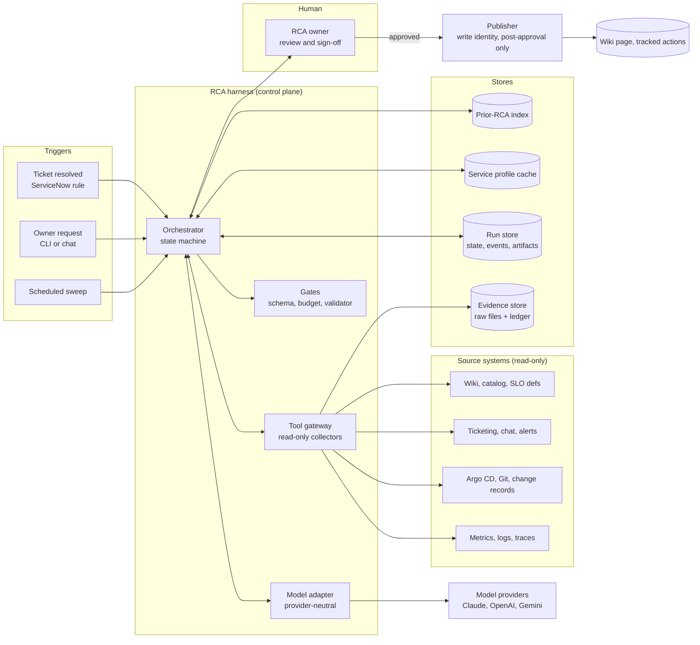
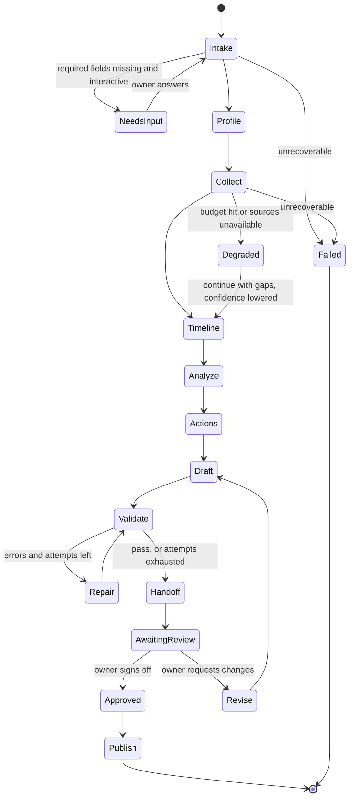
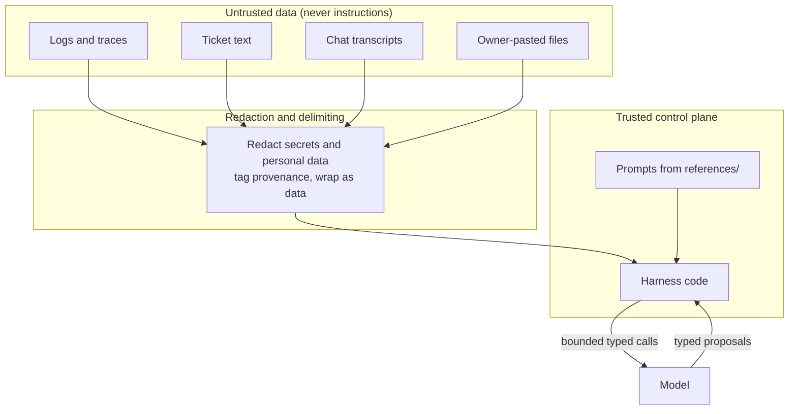

# Architecture: harness-driven RCA authoring

Status: **Proposal for review** · Epic: #1 · Related issues: #7 collectors, #9 redaction and injection tests, #11 eval harness, #12 structured RCA, #14 batch runner

## 1. Summary

Today the skill is *model-driven*: `SKILL.md` asks the model to walk nine phases, and a validator checks the result at the end. Quality depends on the model following the instructions, and the only hard gate is the last step.

A **harness-driven** design inverts control. Deterministic code owns the workflow, the tools, the evidence, the budgets and the gates. The model is called for bounded steps that return typed proposals, and code decides whether each proposal enters the run.

> **The model proposes. The harness disposes.**

The skill does not go away. `SKILL.md` and `references/` stay the single source of truth for method, prompts and template, so the same knowledge works in an interactive agent session (Claude, Codex, Gemini, Copilot) and under the harness.

## 2. Goals and non-goals

**Goals**
1. Make the three failure modes structurally hard, not merely discouraged: invented evidence, blame and shallow causes, action items that never close.
2. Provider-neutral: Claude, OpenAI and Gemini models are swappable behind one interface.
3. Reliable and resumable: a run survives API failures, bounded by budgets, and always ends in a defined state.
4. Cost-effective: no always-on infrastructure at first; spend tokens only where judgement is needed.
5. Safe by construction: read-only investigation identity, untrusted-input handling, redaction before the model sees data.
6. Measurable: the harness is run like a production service, with SLOs, traces and fleet metrics.

**Non-goals**
- Replacing the RCA owner. A human owns conclusions and sign-off; the harness never approves.
- Writing to ticketing, wiki or work tracking during investigation. Publishing is a separate, approved step with a separate identity.
- A general-purpose agent framework. The harness is narrow and built around one workflow.

## 3. Design principles

| Principle | What it means here |
|---|---|
| Code controls flow | Stage order, retries, budgets and termination are code, not prompts. |
| Evidence first | The model can only cite evidence IDs that exist in the run's ledger. A dangling citation is impossible by construction, not just detected. |
| Typed proposals | Every model output is parsed against a schema. Invalid output is retried or rejected, never trusted. |
| Least privilege | Investigation identity is read-only. The model never sees credentials. Write scope exists only in the post-approval publisher. |
| Untrusted by default | Logs, tickets and chat are data. They are redacted, delimited and never treated as instructions. |
| Fail visibly | Missing data becomes a `collection gap` ledger row and a lower Draft Confidence, never a silent skip or a guess. |
| Cheap by default | Cache service profiles, route to the smallest adequate model per stage, stop when extra queries no longer change the ranked hypotheses. |
| Measure the harness | Golden-set evals gate harness and prompt changes like a canary gates a release. |

## 4. System context



The harness is the control plane. The model adapter and tool gateway are the only two things that talk to the outside world, and both are narrow, logged, budgeted interfaces.

## 5. Components

### 5.1 Orchestrator
A deterministic state machine that executes one run. It loads the stage graph, runs each stage, applies gates, checkpoints state after every stage, enforces budgets and decides the next transition. It contains no domain judgement. Implementation: a small Python module over plain functions and files; no framework dependency at first.

### 5.2 Stage runner and stage contracts
Each stage is a function with an explicit contract: input artifacts, output artifact schema, which parts are deterministic, which call the model, its gate, its retry policy and its budget slice. Prompts are loaded from `sre-rca-author/references/` so the skill stays the source of truth.

### 5.3 Model adapter
One interface, many providers.

```
complete(stage, messages, schema, tools=None, budget) -> Result[typed_output, usage]
```

- Adapters for Anthropic, OpenAI and Google behind the same interface; the stage never names a provider.
- **Structured output** against the stage's JSON Schema; the adapter validates and retries once with the validation error before failing the attempt.
- **Tool use loop is owned by the harness**, not the model: the model requests a named tool call, the harness checks it against the stage allowlist and budget, executes it through the tool gateway, and returns a redacted result.
- **Model routing** per stage and tier: a small model for extraction and classification, a strong model for analysis and drafting. Configured in `harness.yaml`, not in code.
- Records prompt hash, model ID, parameters, token usage and latency for every call into the event log.

### 5.4 Tool gateway and collectors
The only path to source systems. Implements issue #7 (framework) and #8 (first adapters).
- **Declarative query catalog**: named, parameterised, read-only requests (for example `argocd.sync_history(app, window)`, `servicenow.incident(number)`, `metrics.slo_burn(service, window, baseline)`). The model chooses from the catalog; it does not write shell or free-form API calls.
- **Allowlist per stage and tier**, and a hard check that adapters perform no write verbs.
- **Pipeline for every call**: authorise, execute with timeout and backoff, store raw output, redact (shared helper, issue #9), hash, append to the ledger, return a bounded summary to the model.
- **Credentials** come from the environment or secret store and never enter prompts, logs or `evidence/`.
- A fallback `FileCollector` ingests owner-supplied exports, so the harness works on day one with no live integrations.

### 5.5 Evidence ledger
Append-only `ledger.jsonl` written only by the gateway. Each row has an ID, source, query, time range, raw-file path, SHA-256, size, status (`ok`, `empty`, `error`), path used and collected-at time. The model sees the ledger as a closed set of IDs and short summaries. Hash verification at validation time detects tampering.

### 5.6 Gates
Code checks between stages. A proposal that fails a gate is retried within budget or rejected.

| Gate | Checks |
|---|---|
| Schema | Output parses against the stage schema |
| Citation | Every cited ID exists in the ledger; numbers trace to the cited row's finding (issue #5) |
| Consistency | Anchor times ordered; derived metrics computed by code, not authored (issue #4) |
| Coverage | Every contributing factor maps to an action or accepted risk; hypotheses count meets the tier |
| Language | Blameless-language scan |
| Final | Full `validate_rca.py` run, plus ledger hash verification |

### 5.7 Run store
A directory per run (section 8) plus an event log. File-based first, so it works locally, in CI and in a container with no database. A database or object store is a later swap behind the same interface.

### 5.8 Service-profile cache and prior-RCA index
Shared across runs (issue #14). The profile is built once per service and reused for 30 days or until its architecture marker changes. The index answers "last five RCAs for this service" and "action closure rate" with queries, not recall.

### 5.9 Publisher
Separate component with a separate write-capable identity. It runs only after the owner approves, renders the structured RCA to the wiki page, creates tracked action items, and writes the tracking IDs back. It is idempotent (keyed by incident ID and RCA hash) so a retry never duplicates work items.

## 6. Run lifecycle



- **Every stage checkpoints** its output artifact and `state.json` before the next begins, so a crashed or interrupted run resumes at the last good stage and completed stages are not re-run or re-paid for.
- **Terminal states** are `Published`, `AwaitingReview` (a finished draft), `Degraded` (a draft with declared gaps) and `Failed` (with a reason). A run never ends silently.
- **Budget exhaustion is graceful**: finish with what exists, lower Draft Confidence, list gaps in Open Questions (consistent with `scale-architecture.md`).

## 7. Stage contracts

`D` = deterministic code, `M` = model call, `H` = human.

| Stage | Inputs | Work | Output artifact | Gate | Model use |
|---|---|---|---|---|---|
| 0 Intake | Request, ticket | D parse and normalise the intake contract; M list missing fields; H answers when interactive | `intake.yaml` | Required fields present, UTC times valid | Small |
| 1 Profile | Service name | D fetch catalog, SLOs, IaC, prior RCAs; M summarise into the profile; cache | `profile.md` (cached) | Unsourced sections marked `UNKNOWN` | Small, once per service |
| 2 Collect | Intake, profile, query catalog | D run the mandatory scan (golden signals, change scan, alerts, chat); M propose follow-up queries from the catalog; stop on budget or no change in ranked hypotheses | `evidence/ledger.jsonl` + raw | Ledger integrity; gaps recorded | Small to medium |
| 3 Timeline | Ledger | D order machine events; M overlay human events and name the five anchors | `timeline.yaml` | Anchors ordered; machine time wins conflicts | Medium |
| 4 Analyze | Ledger, timeline, profile | M quantify impact, locate bottleneck, test at least the tier's number of hypotheses, split trigger / root cause / contributing factors, branching Five Whys; D compute SLO and budget math | `analysis.yaml` | Citation, coverage, language, "cause is a system condition" check | Strong |
| 5 Actions | Analysis | M propose typed actions; D enforce fields, owners from the team list, due-date sanity | `actions.yaml` | Every CF mapped or accepted | Medium |
| 6 Draft | All artifacts | D render the 10-section document from structured data (issue #12); M write prose fields only | `rca.yaml`, `rca.md` | Schema, template contract | Medium |
| 7 Validate / Repair | `rca.md` | D run the validator; M repair only the reported errors; at most 3 loops | `report.json` | Final gate | Medium, scoped |
| 8 Handoff | Everything | D package draft, evidence, report, handoff note; sign-off block fixed at `Pending`; H reviews | `handoff.md` | Never marks approved | None |
| 9 Publish | Approved RCA | D create wiki page and tracked actions with the write identity | Published links | Idempotency key | None |

The pattern to preserve: **numbers, dates, IDs, orderings and mappings are computed or checked by code; the model supplies judgement and prose.**

## 8. Data model and run layout

```
runs/<incident-id>/<run-id>/
  intake.yaml            normalised request
  state.json             stage status, attempts, budget used, model/prompt hashes
  events.jsonl           append-only trace: stage start/end, tool calls, model calls, gate results
  evidence/
    ledger.jsonl         append-only evidence rows
    E-001.json ...       redacted raw outputs (hash-checked)
  profile.md             copy of the cached service profile used
  timeline.yaml
  analysis.yaml
  actions.yaml
  rca.yaml               structured RCA (schema versioned)
  rca.md                 rendered document
  report.json            validator result and metrics
  cost.json              tokens, tool calls, wall-clock by stage
  handoff.md             note for the owner
```

Everything is plain text, diffable and re-runnable. `run-id` includes the harness version and prompt-set hash, so results can be compared across changes.

## 9. Reliability design (SRE view)

The harness is a production service and is treated like one.

### 9.1 Proposed SLIs and SLOs
Targets are proposals to calibrate on the golden set and shadow runs, not commitments.

| SLI | Proposed SLO | Why |
|---|---|---|
| Runs reaching a terminal draft state (not `Failed`) | 95% over 30 days | Owners get a usable draft |
| First-draft validator pass rate | 85% | Matches the scale doc target |
| Time from resolve to first draft, P1 | under 1 hour for 90% | Matches the scale doc target |
| Evidence integrity (ledger hashes verify) | 100% | Non-negotiable invariant |
| Investigation write calls | 0 | Non-negotiable invariant |
| Citations that resolve to a ledger row | 100% | Structural, enforced by gate |

Invariants are enforced by code and tests, not by budget. SLOs get an error budget; a burned budget pauses feature work on the harness in favour of reliability work, as in the SRE error-budget policy.

### 9.2 Failure handling

| Failure | Response |
|---|---|
| Source API outage or rate limit | Retry with exponential backoff and jitter, capped per run; then record a `collection gap` and continue degraded |
| Model API error or timeout | Retry within the stage budget; fail over to the configured fallback model; then fail the stage with a reason |
| Invalid structured output | One retry with the validation error; then reject the attempt |
| Budget exhausted (queries, tokens, wall-clock) | Graceful degrade: finish with what exists, lower confidence, list gaps |
| Validator still failing after 3 repairs | Ship the draft with residual errors at the top of the handoff |
| Worker crash | Resume from the last checkpoint; stages are idempotent |
| Poison input that crashes a run | Mark `Failed`, quarantine the intake, continue the batch (dead-letter) |
| Injection attempt in data | Contained by redaction, delimiting, allowlists and gates; logged as an event |

### 9.3 Load shedding and cost control
Per-tier budgets (P1 full, P2 standard, P3 lite) cap queries, tokens and wall-clock. In batch mode the planner orders by severity and defers P3 under load. Non-urgent runs can use cheaper batch inference.

### 9.4 Safe change of the harness itself
Prompt, model and harness changes are releases. Gate them with the golden-set eval (issue #11) the way a canary gates a rollout: no regression in root-cause match, validator pass rate or hallucination rate, then shadow runs on past incidents, then assist mode, then default.

## 10. Observability

- **Traces:** one trace per run, a span per stage, child spans per model call and tool call (OpenTelemetry-compatible attributes: run ID, incident ID, stage, model, tokens, status).
- **Metrics:** the SLIs above, plus cost per RCA by tier, tool-call counts, gate failure counts by gate, repair loops per run, owner edit ratio and root-cause reversal rate after sign-off.
- **Logs:** structured `events.jsonl` per run; redacted; no secrets and no raw prompts containing evidence unless the run store is access-controlled.
- **Dashboards and alerts:** page on invariant violations (any write call from the investigation identity, any ledger hash mismatch) and on SLO burn; ticket on budget trends.

## 11. Security and trust boundaries



| Threat | Mitigation |
|---|---|
| Prompt injection in logs, tickets or chat | Data is redacted, delimited and labelled with provenance; stages have tool allowlists and no write tools; outputs are schema-checked; sign-off is code-fixed to `Pending`; injection fixtures run in the eval set (issue #9) |
| Secret or personal data leakage into evidence, prompts or the document | Shared redaction in the gateway before storage and before any model call; seeded-secret tests; environment-value scrubbing |
| Over-privileged credentials | Read-only investigation identity; publisher is a separate identity used only after approval; adapters tested for write verbs |
| Fabricated evidence | Ledger written only by the gateway, with hashes; citations restricted to ledger IDs; numeric traceability gate |
| Exfiltration through tools | Fixed query catalog, no arbitrary network or shell tools, egress limited to configured source hosts |
| Cross-incident contamination | One isolated run directory and context per incident; cross-incident insight only in the aggregator |
| Public repo exposure of org wiring | `stack.md` split into a public example and a private copy (issue #10) |

## 12. Deployment options

| Option | Shape | Cost | Fit |
|---|---|---|---|
| A. Local CLI | `rca-harness run INC123` on an engineer's machine or a dev box | None beyond model tokens | **Start here.** Proves the stages, gates and ledger with file-based stores |
| B. CI or job runner | Same container image run from a pipeline or workflow, triggered by a ticket rule or a scheduled sweep | Pay per run | Natural next step; matches a Power Automate or ServiceNow trigger and a work-tracking system |
| C. Queue-backed service | Workers pulling from a queue, shared stores, dashboards | Standing infrastructure | Only when volume or latency requires it |

Because stores and the model adapter are interfaces, moving A to B to C does not change the stage code. Choose C only when batch volume justifies standing infrastructure.

## 13. Relationship to the existing skill

| Concern | Skill (today) | Harness (target) |
|---|---|---|
| Method and prompts | `SKILL.md`, `references/` | Same files, loaded per stage |
| Flow control | Model follows the phases | Orchestrator state machine |
| Evidence ledger | Model writes rows | Gateway writes rows, hash-verified |
| Numbers and mappings | Model computes; validator checks at the end | Code computes or checks at every gate |
| Validator | Final check | Final gate, plus per-stage gates |
| Interactive use | Agent session | Still supported; the harness is optional |

The skill remains the portable, human-friendly entry point. The harness adds enforcement and unattended operation.

## 14. Delivery plan

Phases map to the existing epic; new work is marked **new**.

1. **Foundations (done / in progress):** tests and CI (#2), bundle sync (#3).
2. **Contract hardening:** metric and citation gates (#4, #5, #6). These become the gates the harness reuses.
3. **Evidence plane:** collector framework (#7), redaction and injection fixtures (#9), first adapters (#8). **New:** query catalog format and per-stage allowlists.
4. **Harness core (new):** orchestrator and state machine, run store and checkpointing, event log, `FileCollector`-only end-to-end run, budget enforcement.
5. **Model plane (new):** provider-neutral adapter, structured output, harness-owned tool loop, model routing config, at least two providers.
6. **Structured RCA (#12):** schema-first artifacts and renderer so drafting is mostly code.
7. **Quality loop:** golden-set eval (#11) wired to gate harness changes; shadow mode on past incidents.
8. **Scale (#14):** profile cache, prior-RCA index, batch planner, fleet metrics.
9. **Publisher (new):** idempotent, approval-gated wiki and work-item creation.

A minimal vertical slice to build first: **FileCollector in, Intake to Handoff on one fictional incident, one provider, all gates, file-based stores.** Everything after that is widening.

## 15. Decisions and open questions

| # | Decision | Recommendation | Needs |
|---|---|---|---|
| D1 | Harness language | Python, stdlib-first, so it matches `validate_rca.py` and keeps the install light; add provider SDKs behind the adapter | Confirm |
| D2 | Framework | None initially; a plain state machine over functions. Revisit only if resumability or fan-out outgrows it | Confirm |
| D3 | First provider | Pick one for the vertical slice, add a second to prove neutrality | Your call |
| D4 | First deployment | Option A, designed for B | Confirm |
| D5 | Where run artifacts live | Local directory first; object store later behind an interface | Confirm |
| D6 | TTM definition (detected vs impact start) | Decide before the metric gate lands (#4) | Your call |
| D7 | Human checkpoints | Intake clarification, a hypothesis review after Analyze for P1, and final sign-off. More checkpoints raise quality and latency | Your call |
| D8 | Which data may reach which model provider | Needs a data-handling decision per provider before any live evidence is used | Security / policy |

## 16. What this architecture buys

- Invented evidence cannot enter the document: citations resolve to hash-verified ledger rows or the gate rejects them.
- Arithmetic and structure drift cannot survive: dates, durations, budgets and mappings are computed or checked by code.
- Cost is bounded and visible: budgets per tier, routing per stage, cached profiles, early stopping.
- The model is replaceable, so quality and cost can be tuned per provider with the same eval.
- The agent is operable like any other service: traces, SLOs, an error budget and safe rollout of its own changes.
